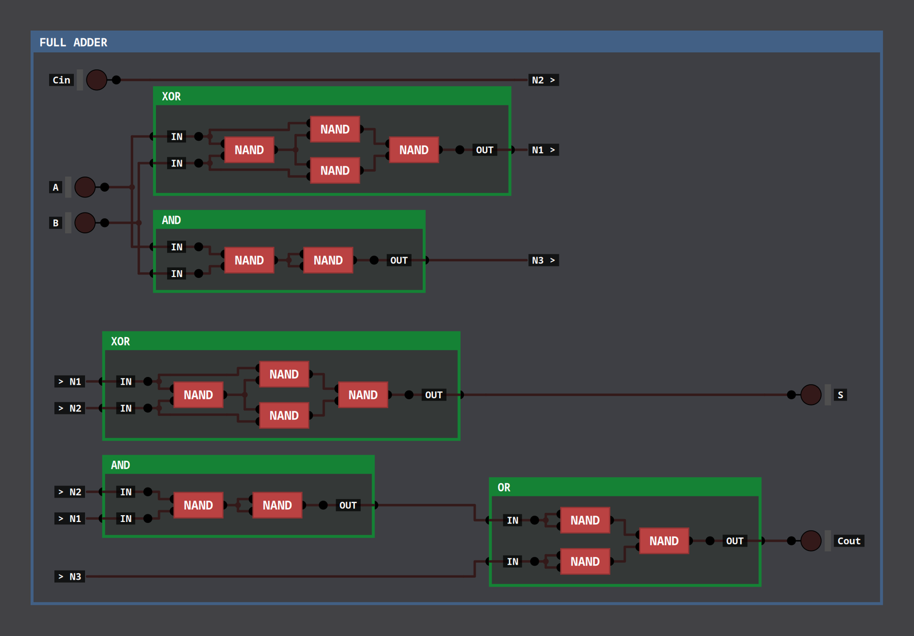

# DLS Image Exporter

Batch-export the chips you've built in [Digital Logic Sim](https://github.com/SebLague/Digital-Logic-Sim)
(v2.x) as images: every chip in every project with one command, either as you laid it out
or opened up all the way down to its NAND gates.



It's a single Python script that reads your save files directly (read-only), so it works
with the regular game build and needs no mods. Requires Python 3 and `pycairo`.

Saves are auto-detected from
`~/.config/unity3d/SebastianLague/Digital-Logic-Sim/Projects` on Linux and the usual
Windows/macOS locations; point `--saves` somewhere else if needed.

## Modes

| Mode       | Output folder                  | What it shows |
|------------|--------------------------------|---------------|
| `circuit`  | `exports/<project>/circuit/`   | The inside of each chip, as you laid it out in the editor |
| `expanded` | `exports/<project>/expanded/`  | Every custom sub-chip opened up in place, recursively. Each one becomes a bordered frame, titled with the chip's name, holding its own inner circuit |

## Layouts

| Layout     | Default for | What it does |
|------------|-------------|--------------|
| `original` | `circuit`   | Keeps your placement and your wire bends. In expanded mode, the space around each opened chip is stretched to make room, so straight wires stay straight |
| `auto`     | `expanded`  | Rearranges the parts and re-routes the wires to use far less space, so gates are readable without zooming in |

The auto layout places each chip's parts in columns by signal flow (inputs on the left,
outputs on the right), with feedback loops such as latches routed back around. Parts are
ordered to reduce wire crossings and lined up with whatever drives them, so most wires
run straight. Wires are routed horizontally and vertically through the gaps between
columns, each vertical run on its own track, and dots mark where a wire branches.
Layouts much wider than the target shape (`--aspect`, default 1.8) wrap into rows; a
wire that crosses a row break ends in a named tag (`N3 >`) and continues from the
matching tag (`> N3`) on the next row.

## Common commands

```sh
python3 dls_export.py                         # all projects, all chips, both modes (PNG)
python3 dls_export.py --list                  # list projects and chips
python3 dls_export.py -p ALU                  # one project
python3 dls_export.py -p ALU -c ALU "FULL ADDER"           # specific chips
python3 dls_export.py -p ALU --mode expanded --format svg   # vector output
python3 dls_export.py --mode expanded --layout original    # keep your own layout
python3 dls_export.py --mode expanded --depth 1            # open only one level
python3 dls_export.py --mode expanded --collapse AND,OR,NOT   # keep these chips closed
python3 dls_export.py --lit                   # bright wire colours (easier to see)
```

Other flags: `--aspect` (row wrapping for the auto layout; `0` turns it off), `--scale`
(pixels per unit, default 100), `--max-px` (PNG size cap, default 16000; larger images
are scaled down, so use `--format svg` for very big chips), `--grid`, `--no-pin-names`,
`--chip-pin-names`, `--out DIR`, `--font FAMILY`.

## Notes

- Chip sizes, pin spacing, the built-in chips and multi-bit wire drawing follow the
  public Digital Logic Sim source, so in the `original` layout wires meet pins where
  they do in the game.
- Wires are drawn in their "off" colours, since nothing is being simulated. Use
  `--lit` for the bright "on" colours.
- The chip's own IN/OUT pin names are drawn on the outer side of each pin, so they
  don't cover wires.

This is an independent tool, not affiliated with Sebastian Lague or Digital Logic Sim.
