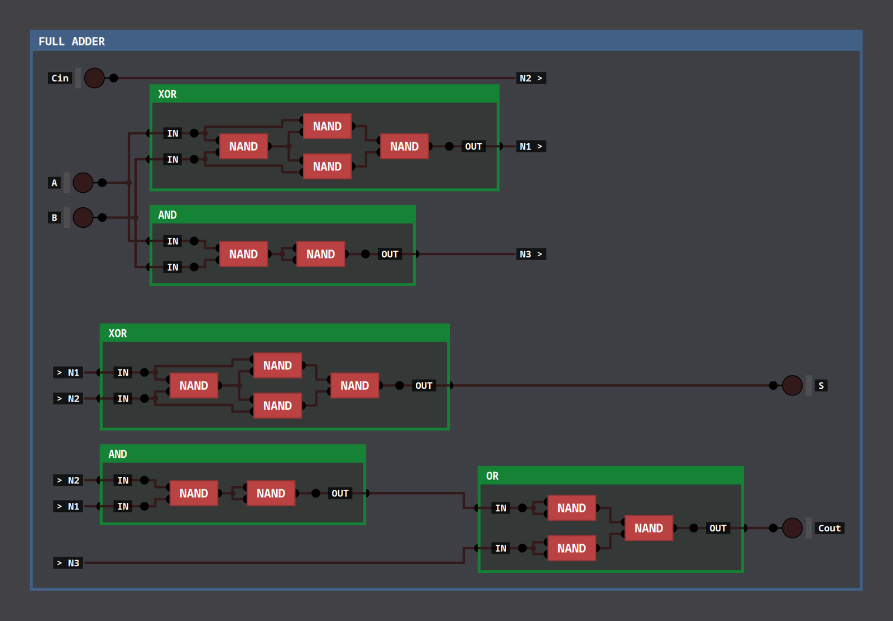

# DLS Image Exporter

Exports Digital Logic Sim chips as images, opened up to their NAND gates.

## Table of Contents

- [About](#about)
- [Screenshots](#screenshots)
- [Features](#features)
- [Technologies](#technologies)
- [Setup](#setup)
- [Usage](#usage)
- [Project Status](#project-status)
- [Credits](#credits)
- [Author](#author)

## About

A Python script that batch-exports the chips you've built in [Digital Logic Sim](https://github.com/SebLague/Digital-Logic-Sim) (v2.x) as PNG or SVG images: every chip in every project with one command, either as you laid it out or opened up all the way down to its NAND gates. I made it for clearer visuals of my [8-bit ALU](https://areeb-ece.github.io/projects/alu/), and I expect to use it for future Digital Logic Sim projects too.

## Screenshots



## Features

- Two modes
  - **Circuit:** the inside of each chip
  - **Expanded:** every custom sub-chip opened in place, recursively, each in a titled frame
- Two layouts
  - **Auto** (default): parts rearranged by signal flow and wires re-routed to be easy to follow
  - **Original:** the editor's placement and wire bends
- PNG or SVG
- Limit an export to some projects or chips, a few levels, or keep chosen chips closed
- Wires in their off colours, or lit
- Reads the game's save files directly (read-only), so no mods are needed

## Technologies

- Python 3.8 or later (single script, `dls_export.py`)
- pycairo 1.15 or later, for drawing PNG/SVG. Older versions fail because the script reads text measurements by name (`text_extents(...).x_advance`), which pycairo added in 1.15.
- Tested: a full export of 60 images runs cleanly on Python 3.8 with pycairo 1.15.0, and on Python 3.14 with pycairo 1.29.
- Python standard library only otherwise: `argparse`, `colorsys`, `json`, `math`, `os`, `re`, `sys`
- No manifest or lockfile

### How it's put together

The auto layout places each chip's parts in columns by signal flow (inputs on the left,
outputs on the right), with feedback loops such as latches routed back around. Parts are
ordered to reduce wire crossings and lined up with whatever drives them, so most wires
run straight. Wires are routed horizontally and vertically through the gaps between
columns, each vertical run on its own track, and dots mark where a wire branches. After
placing the parts, it nudges them wherever there's room so that more wires run dead level
instead of taking small jogs.
Bit splitters and mergers (`8-1BIT`, `1-8BIT` and the 4-bit ones) are left out. A bus
whose bits all go to the same place is drawn as one thick wire with a dark centre line.
Where a bus splits up, it's drawn as one wire per bit, close together and in bit order
(highest bit on top, as the game lays out bus pins), and each bit peels off on its own
toward where it goes, crossing the others where it has to. Single-bit wires join a bus at a multi-bit pin in the same
bit order. Each wire is traced through the splitters to the pin that really drives it.

Layouts much wider than the target shape (`--aspect`, default 1.8) can wrap into rows,
and every wire is still drawn whole: a wire crossing a row break runs down the right edge
of its row, back along its own lane in the gap between rows, and into the next row from
the left. Because those looping wires cost space and clarity, a layout only wraps when
the better shape outweighs them, so a small chip whose wires mostly cross the break
(like an 8-bit ripple-carry adder) stays in one long row.

## Setup

### Prerequisites

- Python 3.8 or later
- `pycairo` 1.15 or later
- Digital Logic Sim (v2.x) save files

### Install

```bash
pip install pycairo
```

Or install your distro's `python-cairo` package instead (this is what the script's own error message suggests).

### Input

The script reads the game's Projects folder (`*.json` chip saves and `ProjectDescription.json`). It is auto-detected from:

- Linux: `~/.config/unity3d/SebastianLague/Digital-Logic-Sim/Projects`
- Windows: `~/AppData/LocalLow/SebastianLague/Digital-Logic-Sim/Projects`
- macOS: `~/Library/Application Support/com.SebastianLague.Digital-Logic-Sim/Projects` or `~/Library/Application Support/SebastianLague/Digital-Logic-Sim/Projects`

Point `--saves` somewhere else if your saves live elsewhere.

### Run

```bash
python3 dls_export.py
```

## Usage

### Modes

| Mode       | Output folder                  | What it shows |
|------------|--------------------------------|---------------|
| `circuit`  | `exports/<project>/circuit/`   | The inside of each chip |
| `expanded` | `exports/<project>/expanded/`  | Every custom sub-chip opened up in place, recursively. Each one becomes a bordered frame, titled with the chip's name, holding its own inner circuit |

### Layouts

| Layout     | What it does |
|------------|--------------|
| `auto` (default) | Rearranges the parts and re-routes the wires so the circuit is easy to follow, and uses far less space, so gates are readable without zooming in |
| `original` | Keeps your placement and your wire bends. In expanded mode, the space around each opened chip is stretched to make room, so straight wires stay straight |

### Common commands

```bash
python3 dls_export.py                         # all projects, all chips, both modes (PNG)
python3 dls_export.py --list                  # list projects and chips
python3 dls_export.py -p ALU                  # one project
python3 dls_export.py -p ALU -c ALU "FULL ADDER"           # specific chips
python3 dls_export.py -p ALU --mode expanded --format svg   # vector output
python3 dls_export.py --layout original      # keep your own layout
python3 dls_export.py --mode expanded --depth 1            # open only one level
python3 dls_export.py --mode expanded --collapse AND,OR,NOT   # keep these chips closed
python3 dls_export.py --lit                   # bright wire colours (easier to see)
```

### Flags

| Flag | Meaning |
|------|---------|
| `--aspect` | Row wrapping for the auto layout (default 1.8; `0` turns it off) |
| `--keep-splitters` | Auto layout: draw the splitter and merger chips after all |
| `--scale` | Pixels per unit (default 100) |
| `--max-px` | PNG size cap (default 16000); larger images are scaled down, so use `--format svg` for very big chips |
| `--saves` | Projects folder to read (default: auto-detected) |
| `--grid` | Draw the background grid |
| `--no-pin-names` | Hide the names on the chip's own IN/OUT pins |
| `--chip-pin-names` | Show pin names on every sub-chip |
| `-o`, `--out DIR` | Output folder (default: `exports/` next to the script) |
| `--font FAMILY` | Font family for text (default: monospace) |

### Notes

- Wires are drawn in their "off" colours, since nothing is being simulated. Use
  `--lit` for the bright "on" colours.
- The chip's own IN/OUT pin names are drawn on the outer side of each pin, so they
  don't cover wires.

## Project Status

**Complete**, and still updated when something should be added or changed.

Next up: a graphical interface (GUI), so exports can be set up without the command line.

## Credits

- [Digital Logic Sim](https://github.com/SebLague/Digital-Logic-Sim) by Sebastian Lague, the game whose saves this tool reads.
- Chip sizes, pin spacing, the built-in chips and multi-bit wire drawing follow the
  public Digital Logic Sim source, so in the `original` layout wires meet pins where
  they do in the game.

This is an independent tool, not affiliated with Sebastian Lague or Digital Logic Sim.

## Author

Made by areeb ([areeb-ece.github.io](https://areeb-ece.github.io), [GitHub](https://github.com/areeb-ece)).
